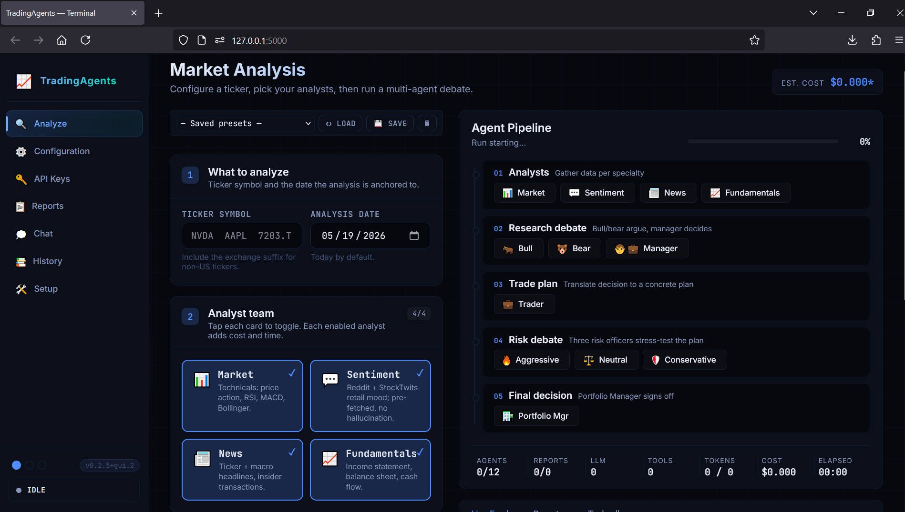

# TradingAgents-GUI

A polished local web GUI on top of [TauricResearch/TradingAgents](https://github.com/TauricResearch/TradingAgents), the multi-agent LLM trading framework. Designed so anyone can run a full multi-agent analysis on their own laptop — install once, then click a single script to launch.

**Fork of** [TauricResearch/TradingAgents](https://github.com/TauricResearch/TradingAgents) · **This repo**: [TheLocalLab/TradingAgents-GUI](https://github.com/TheLocalLab/TradingAgents-GUI) · **Tracks upstream v0.2.5**

> **Educational software. Not financial advice. LLMs hallucinate — verify every claim before trading on it.**



## Example reports

Each run produces a multi-section markdown report (Market / Sentiment / News / Fundamentals → Research debate → Trade plan → Risk debate → Portfolio decision). Live samples produced by the pipeline:

| Ticker | View in browser | Raw source |
| --- | --- | --- |
| **AAPL** | [📄 Open report](https://htmlpreview.github.io/?https://github.com/TheLocalLab/TradingAgents-GUI/blob/main/assets/examples/AAPL_report.html) | [AAPL_report.html](assets/examples/AAPL_report.html) |
| **NVDA** | [📄 Open report](https://htmlpreview.github.io/?https://github.com/TheLocalLab/TradingAgents-GUI/blob/main/assets/examples/NVDA_report.html) | [NVDA_report.html](assets/examples/NVDA_report.html) |
| **MRVL** | [📄 Open report](https://htmlpreview.github.io/?https://github.com/TheLocalLab/TradingAgents-GUI/blob/main/assets/examples/MRVL_report.html) | [MRVL_report.html](assets/examples/MRVL_report.html) |

(GitHub displays `.html` files as raw source; the **Open report** column wraps them through `htmlpreview.github.io` so they render in-browser. You can also save the raw file and open it locally.)

---

## What you get

Based on upstream **TradingAgents v0.2.5**, with selected fixes from later releases ported in (see [Upstream compatibility](#upstream-compatibility)), then adds:

| Feature | Notes |
| --- | --- |
| **Polished Analyze tab** | Numbered-step form, larger inputs, segmented Depth + Report-Length controls, live cost estimate. |
| **Report-length control** | Three modes (Concise / Standard / Comprehensive) — injects a directive into every agent prompt to control how verbose the saved report is. Save tokens on a "Concise" run. |
| **Visual pipeline** | Vertical stages with real progress bars; agents show pending / in-progress / completed / errored. |
| **Tabbed output area** | Live Feed, Reports preview, Tool calls — each in its own pane with proper breathing room. |
| **Final decision card** | Color-coded by rating (Buy / Overweight / Hold / Underweight / Sell) with one-click copy. If the Portfolio Manager's answer has no readable rating it shows **REVIEW** instead of guessing a Hold. |
| **Reports tab redesign** | 3-pane: searchable index, table of contents, reader. Re-run with one click, export `.md` / `.html` / `.pdf`, delete from the UI. |
| **Live Health/Setup tab** | Replaces the static "instructions" tab. Diagnostics for Python version, deps, key configured, results dir writable, disk space. |
| **First-run wizard** | Auto-opens when no provider key is set: pick a provider, paste a key, test it, you're done. If it finds data from another install it asks whether to keep it or start fresh. |
| **Local data controls** | Runs, chats, presets and UI preferences are saved in `~/.tradingagents/` and survive restarts and private windows. A **Danger Zone** on the API Keys tab wipes them by category (you must type `WIPE`). See [Configuration](#configuration). |
| **Chat tab** | Multi-session chat with any provider you have a key for; pin past reports as grounding context; live token-counter with context-window warning. |
| **Theme system** | Three built-in themes: **Terminal** (default, blue neon), **Modern** (clean cyan), **Bloomberg** (black + amber/green, mono-heavy). Persists in localStorage. |
| **Real Stop / Cancel** | Backend supports cooperative cancellation via a `threading.Event`. The Stop button actually works. |
| **Live-run pill** | Visible from any tab. Shows the in-flight ticker and current agent. Click to jump back to Analyze. |
| **Browser notifications** | Notification (or in-tab banner fallback) when a run completes. |
| **Dual-region providers** | Qwen-CN, GLM-CN, MiniMax-CN are now first-class — no more hardcoded provider list. |
| **Cleaner backend** | Refactored from one 817-line `app.py` into focused modules (`agent_map.py`, `providers.py`, `env_store.py`, `run_manager.py`, `chat.py`, `stats.py`). |

The multi-agent pipeline (agents, prompts, graph) is upstream's. This fork is mainly a GUI wrapper, plus targeted compatibility and reliability fixes in the framework layer (provider quirks, tool-argument guards, a per-analyst tool-round cap). See [Upstream compatibility](#upstream-compatibility).

---

## Prerequisites

- **Python 3.10 or newer** (3.11 recommended)
- **Git** (only if you're cloning manually — the one-click installer handles this)
- An API key for at least one LLM provider (OpenAI, Anthropic, Google, OpenRouter, DeepSeek, xAI, Qwen, GLM, MiniMax, or local Ollama)

Don't have Python? On **Windows**, the [one-click installer below](#zero-install-windows--recommended-for-new-users) ships its own Python 3.11 (via portable Miniconda) and Git — nothing else to install. On **macOS / Linux**, install Python via your package manager (`brew install python@3.12`, `sudo apt install python3.12 python3.12-venv`, `sudo dnf install python3.12`) and use the manual path below.

## Quickstart

### Zero-install (Windows) — recommended for new users

Support the project by getting the one-click Windows installer from my Patreon post. Download `TradingAgents-GUI-OneClick.bat`, place it in an empty folder, and double-click it. It installs portable Git, Miniconda, and Python 3.11, clones the repo, installs dependencies, and creates `start_WebUI.bat` for future launches. Safe to re-run; it skips anything that already exists.

Access the installer here: [Patreon post](https://www.patreon.com/posts/trading-agents-158823717)

### Manual install — if you already have Python 3.10+

**Windows**

```bat
install.bat
```

**macOS / Linux**

```bash
./install.sh
```

This creates a `.venv/` in the project folder and installs the framework plus GUI dependencies. Takes ~1 minute the first time.

### Launching (after install)

**Windows**

```bat
start.bat
```

**macOS / Linux**

```bash
./start.sh
```

Open [http://localhost:5000](http://localhost:5000) in your browser. The first-run wizard will guide you through pasting an API key.

> **Why are install and start separate?** Because you only need to install once. Subsequent launches are instant — `start` is just a thin wrapper around `python -m gui.app`. If you forget and run `start.bat` first, it tells you to run `install.bat` instead.

### Docker

```bash
docker compose up
```

Then open [http://localhost:5000](http://localhost:5000). Reports persist in `./results/`.

For local Ollama:

```bash
docker compose --profile ollama up
```

---

## Setting up your first run

1. **Open the GUI** — the launcher does this for you.
2. **Setup wizard** — appears automatically. Pick a provider, paste a key, click **Test connection**.
3. **Type a ticker** on the Analyze tab (e.g. `AAPL`).
4. **Pick analysts** (cards toggle on click) and a **report length** (Concise saves money).
5. Click **Run analysis**. The pipeline lights up; live stats tick at the bottom.
6. When it's done, the green decision card shows the verdict. Reports auto-save under `~/.tradingagents/logs/<ticker>/<date>/`.

> First run on a ticker can take **5–20 minutes** depending on model and analyst selection. Cached runs are faster.

---

## Configuration

Where things are saved:

| Where | What |
| --- | --- |
| `.env` (project root) | API keys, provider/model defaults. Managed from the **API Keys** tab. **Per install**: it lives in the project folder. |
| `~/.tradingagents/logs/` | Saved reports, one folder per `<ticker>/<date>/`. |
| `~/.tradingagents/runs.json` | Run history and per-run stats (tokens, cost, decision). Drives the Reports and History tabs. |
| `~/.tradingagents/chat/` | Chat sessions (one JSON file each). |
| `~/.tradingagents/presets/` | Saved Analyze-form presets. |
| `~/.tradingagents/ui_state.json` | UI preferences (theme, selected provider and models, vendors, …). |
| `~/.tradingagents/memory/` | The agents' persistent decision memory log. |

> **`~/.tradingagents/` is shared by every install on the same user account.** A fresh install in a new folder
> still sees your old reports, chats and settings, and deleting the project folder does *not* delete them.
> Only `.env` (your API keys) goes with the project folder.

To clear that data, open **API Keys → Danger Zone**, tick the categories to remove, and type `WIPE` to confirm.
It affects *every* install on this machine and cannot be undone. Your API keys in `.env` are not touched.

Provider env-vars the GUI sets (also editable by hand):

```bash
TRADINGAGENTS_LLM_PROVIDER=openai
TRADINGAGENTS_DEEP_THINK_LLM=gpt-5.4
TRADINGAGENTS_QUICK_THINK_LLM=gpt-5.4-mini

OPENAI_API_KEY=sk-...
ANTHROPIC_API_KEY=sk-ant-...
GOOGLE_API_KEY=...
# (one row per provider — see Models & Keys tab)
```

Optional settings (all can go in `.env`):

```bash
# Safety caps
TRADINGAGENTS_MAX_TOOL_ROUNDS=20     # tool-call rounds an analyst gets before it must write its report (default 20)
TRADINGAGENTS_MAX_TOKENS=4096        # cap output tokens per LLM call (unset = provider default; must be a whole number)

# Remote / containerized setups
OLLAMA_BASE_URL=http://192.168.1.50:11434   # Ollama on another machine ("/v1" is added for you if missing)
TRADINGAGENTS_LLM_BACKEND_URL=...    # default backend URL shown for Ollama in the GUI
TRADINGAGENTS_GUI_HOME=/data         # where the GUI keeps its .env when the install folder is read-only (e.g. Docker)
```

The analyst cap exists because a model that keeps asking for tools would otherwise run the graph into its
recursion limit and kill the whole run. At the cap, the analyst is told to write its report from the data
it has already gathered. Set it to `0` to turn the cap off.

### Report length

In the **Analyze** form, the **Report length** segmented control picks:

| Mode | Behavior |
| --- | --- |
| **Concise** | Each agent is told to aim for ~300 words. Compact tables. Saves ~50% tokens vs. Standard. |
| **Standard** | Current default behavior — no extra instruction. |
| **Comprehensive** | Each agent is told to be thorough, multi-row tables, long-form. Best for serious research; costs more. |

Implementation: a single `get_brevity_instruction()` helper in `tradingagents/agents/utils/agent_utils.py` appends a directive to every agent's system prompt based on `config["report_brevity"]`. Touches all 12 agents (analysts + researchers + trader + risk + portfolio).

---

## Themes

Three dots in the lower-left of the sidebar:

- **Terminal** — blue neon, finance-terminal aesthetic (default).
- **Modern** — cleaner cyan, softer corners, less glow.
- **Bloomberg** — black + amber/green, mono-heavy, sharper corners, uppercase headers.

Saved with your other UI preferences in `~/.tradingagents/ui_state.json`, so your choice survives restarts and private windows.

---

## CLI still works

The upstream CLI is fully preserved:

```bash
.venv\Scripts\python.exe -m cli.main     # Windows
.venv/bin/python -m cli.main             # macOS / Linux
```

Or after installing, the entry-point scripts work too:

```bash
tradingagents          # original interactive CLI
tradingagents-gui      # this fork's GUI (same as start.bat / start.sh)
```

---

## Troubleshooting

| Symptom | Fix |
| --- | --- |
| `start.bat` says "no virtual environment" | Run `install.bat` first. |
| Browser doesn't open | Manually visit `http://127.0.0.1:5000`. |
| "No API key set" in Setup tab | Open **API Keys** tab, paste a key, click Save. The first-run wizard does this too. |
| Run hangs at the first analyst | Almost always a bad key or network/proxy block. Use the **test** button next to your key. |
| PDF export looks odd / has extra header | The browser's Save-as-PDF dialog is used — pick "Save as PDF" as the destination, then tweak margins/scale in the print preview if needed. (As of v0.2.5+gui.2 the WeasyPrint server-side path was removed in favor of this zero-install browser route.) |
| Tokens or context "$0" | Pricing is only built in for some models, and the newest ones may not be listed yet, so their estimate shows `$0`. The estimator is informational, not a billing system. |
| Decision shows **REVIEW** | The Portfolio Manager's answer had no readable `Rating:` line (or its ratings disagreed), so no call was recorded rather than guessing a Hold. Read the report and re-run if needed. |
| "Address already in use" / port 5000 busy | Another app (often macOS AirPlay) holds port 5000. Start on another port: `tradingagents-gui --port 5001`. |
| I reinstalled but still see my old reports / chats | Those live in `~/.tradingagents/`, which every install on your account shares. Use **API Keys → Danger Zone** to clear them. |
| Want to expose to LAN | `start.bat --host 0.0.0.0`. **Do not expose to the public internet** — no auth layer. |
| Where are my reports? | `~/.tradingagents/logs/<ticker>/<date>/reports/complete_report.md`. The **Reports** tab is a viewer for that folder. |

---

## Upstream compatibility

This fork (version `0.2.5+gui.2`) is rebased on **upstream v0.2.5**. The `+gui.2` is a PEP 440 "local version identifier" — pip / setuptools recognise it as "upstream 0.2.5 with local modifications."

Notable v0.2.5 upstream changes baked in:

- **Sentiment Analyst redesign** — replaces the old `social_media_analyst`. Pre-fetches Reddit + StockTwits data instead of letting the LLM tool-call (kills a class of hallucinations).
- **Dual-region providers** — Qwen, GLM, and MiniMax each have international and China endpoints with separate keys.
- **Remote Ollama** — `OLLAMA_BASE_URL` lets the framework hit an Ollama instance on another machine.
- **Auto-key-detection** — providers advertise which env var holds their key.

### Ported from later upstream releases

Upstream is well past v0.2.5 (v0.7.0 at the time of writing). Selected fixes have been cherry-picked in:

- **Model catalog** refresh (GPT-6, Claude Opus 5.5 / Fable 5.1 / Sonnet 5, Gemini 3.8, Grok 4.6, GLM-5.3, Qwen 3.8, MiniMax-M3, DeepSeek Flash). Previous generations stay selectable.
- **Strict rating parsing** — a rating is read only from its `Rating:` label, and an unreadable decision is flagged `REVIEW` instead of becoming a fake Hold.
- **Gemini request timeout** (600 s) so a stalled call can't hang a run.
- **Analyst tool-round cap** and the optional `TRADINGAGENTS_MAX_TOKENS` output cap.
- **Data fixes** — null-safe Yahoo news, crypto subreddits for coin tickers, and currency labels on Yahoo fundamentals.

### Not ported yet

Parallel analysts, a separate provider per model tier, ChatGPT-plan sign-in, backtesting, SEC EDGAR fundamentals and
upstream's point-in-time (look-ahead) fixes. Upstream reorganised its packages in v0.5.1, so these can't be
rebased in; they need a deliberate port.

This fork can't simply track upstream anymore. I cherry-pick what applies cleanly and port the bigger features on purpose. The GUI deliberately lives in its own `gui/` package so upstream changes stay easy to absorb.

---

## Architecture

```
TradingAgents-GUI/
├── tradingagents/                ← upstream framework + targeted fixes (see Upstream compatibility)
│   ├── agents/utils/agent_utils.py   ← get_brevity_instruction helper
│   ├── agents/utils/tool_guard.py    ← keeps malformed tool calls from crashing a run
│   └── graph/setup.py                ← analyst tool-round cap
├── cli/                          ← upstream CLI
├── tests/                        ← pytest suite
├── gui/                          ← this fork's GUI
│   ├── app.py                    ← Flask routes
│   ├── run_manager.py            ← Concurrent runs, cancellation, event fan-out
│   ├── chat.py                   ← Multi-session chat with pinned reports
│   ├── env_store.py              ← Atomic .env IO with safe masking
│   ├── agent_map.py              ← Agent / team / report-section canonical metadata
│   ├── providers.py              ← Provider catalog driven by upstream api_key_env
│   ├── stats.py                  ← Token pricing + cost estimator
│   ├── presets.py                ← Saved Analyze-form presets
│   ├── ui_state.py               ← Server-side UI preferences
│   ├── templates/index.html      ← Single-page UI
│   └── static/
│       ├── css/style.css         ← Themes + all component styles
│       ├── js/app.js             ← Original tab/event logic
│       └── js/app_v2.js          ← Phase-4-onward redesign hooks
├── install.bat  / install.sh     ← One-time environment setup
├── start.bat    / start.sh       ← Launch the GUI (refuses if no .venv)
├── Dockerfile                    ← CLI image for containerized deployment
├── Dockerfile.gui                ← GUI image (serves on 0.0.0.0:5000)
└── docker-compose.yml
```

**Transport:** REST for stateless reads / writes, Server-Sent Events for live run output and chat streaming.

**Concurrency:** runs execute on background threads (the graph is synchronous). Cancellation is cooperative via a `threading.Event` polled between graph chunks.

---

## Credits

- Original framework: [TauricResearch/TradingAgents](https://github.com/TauricResearch/TradingAgents) — all the heavy thinking lives there.
- This fork's GUI is maintained as a long-running personal fork; not aiming for an upstream merge.

## License

Same as upstream — see [LICENSE](LICENSE).

---

## About — The Local Lab

Maintained by **The Local Lab**. Tune in for the best available AI tools, made easy.

- 🎥 **YouTube** — [youtube.com/@TheLocalLab](https://www.youtube.com/@TheLocalLab)
- 💖 **Patreon** — [patreon.com/cw/TheLocalLab](https://www.patreon.com/cw/TheLocalLab) — exclusive one-click Windows installers, ComfyUI workflows, and AI resources. Skip the manual node + model setup and get straight to creating.
- 🐦 **X** — [@TheLocalLab_](https://x.com/TheLocalLab_)
